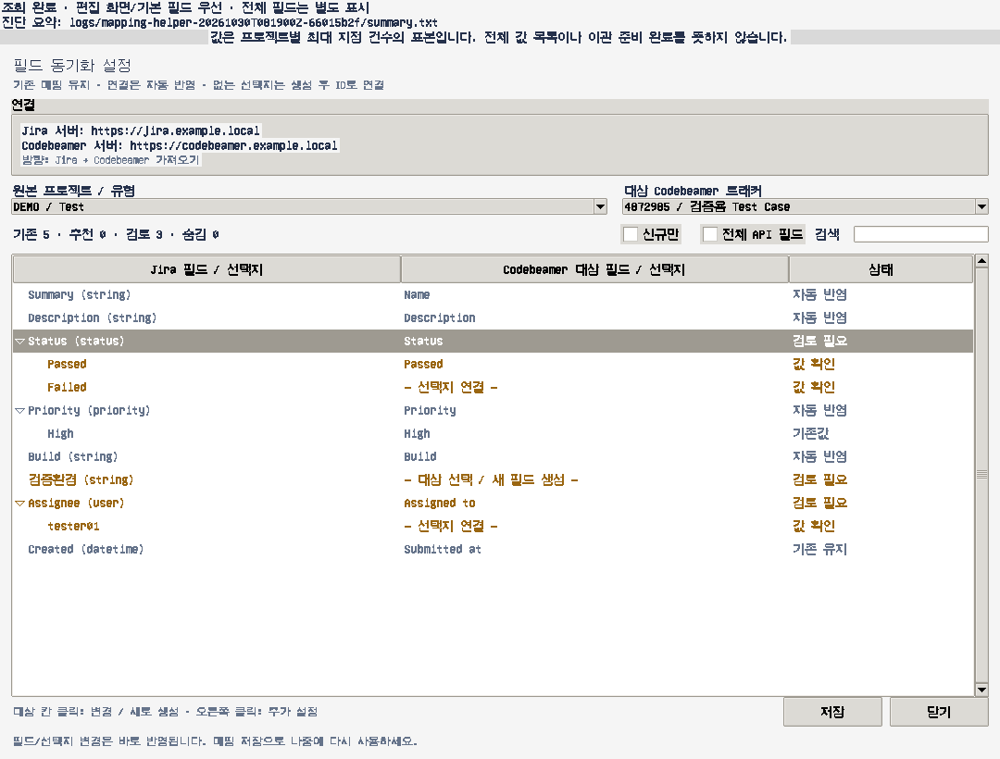
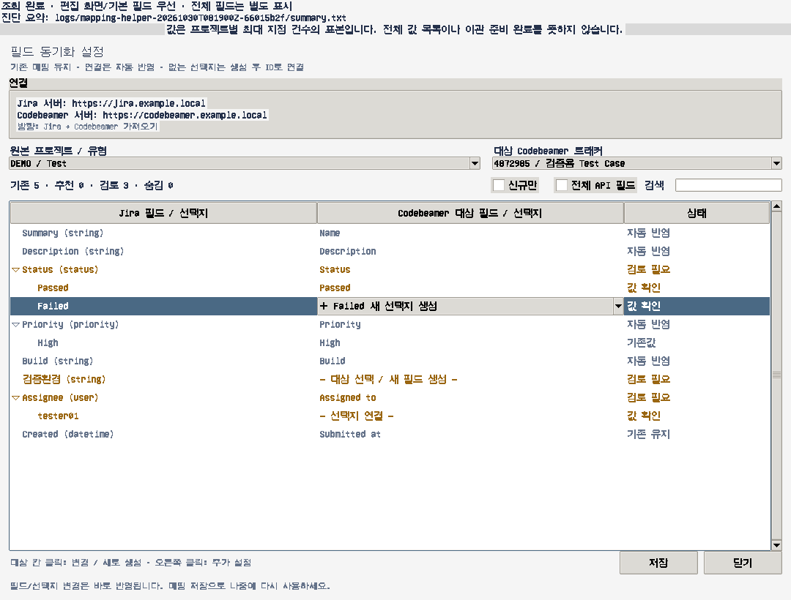

# Jira DC + Xray → Codebeamer Python 마이그레이터

**현재 기본 실행 범위는 Test Run만 이관입니다.** 설정과 제한은 문서 하단의 “현재 사용 범위: Test Run만 이관”을 먼저 확인하세요. 다른 데이터와 Test Plan–요구사항 관계는 별도 도구로 처리합니다.

Python 3.10 이상, Windows/VS Code 지원. 외부 패키지는 필요하지 않습니다.
기존 저장소에는 README만 있어 API 클라이언트와 마이그레이션 엔진을 새로 작성했습니다.

**현재 상태:** 실행 가능한 엔진 및 모의 서버 검증 구현입니다. Codebeamer 실제 Swagger와 요청/응답에 맞는 설정을 입력하기 전에는 운영 이관에 사용할 수 없습니다. 실서버 쓰기 검증은 수행하지 않았습니다. 기본 설정으로 정상 완료를 보고하지 않습니다.

## 실행

PowerShell에서 이 디렉터리로 이동한 뒤:

```powershell
Copy-Item config.json config.local.json
python main.py diagnose-connection --config config.local.json --tracker-id 4862420 --prompt-auth
python main.py discover --config config.local.json --prompt-auth
python main.py migrate --config config.local.json
python -m unittest discover -s tests -v
```

Jira는 기본 Bearer 인증, Codebeamer는 기본 Basic(아이디·비밀번호) 인증입니다. `--prompt-auth`는 누락된 인증정보를 실행 중 입력받으며 토큰과 비밀번호를 화면에 표시하거나 파일에 저장하지 않습니다. 자동 실행 시 Jira는 `JIRA_TOKEN`, Codebeamer는 `CB_USERNAME`/`CB_PASSWORD` 환경변수를 사용하세요. Codebeamer 토큰 인증은 `auth: "bearer"`, `token_env: "CB_TOKEN"`으로 변경할 수 있습니다. HTTPS 및 OS/Python CA 검증을 유지합니다. 신뢰하는 사내 HTTP 서버는 해당 서버 설정의 `allow_http: true`로 명시적으로 허용할 수 있습니다. HTTP Basic 인증은 네트워크 구간에서 암호화되지 않으므로 가능하면 HTTPS를 사용하세요. 다른 서버로의 리디렉션 및 인증정보 전달은 거부합니다. 사내 CA는 신뢰 저장소 또는 지원되는 `SSL_CERT_FILE`로 제공하세요. 인증정보를 설정 JSON에 넣지 마세요.

`discover`: Jira 프로젝트·필드, Codebeamer Swagger 및 매핑된 트래커 설정/필드를 저장하는 읽기 전용 명령입니다. `codebeamer.url`과 실제 JSON Swagger URL인 `swagger_url`을 설정해야 합니다. 이미 받은 Swagger 파일은 `file:C:/path/openapi.json`도 지원합니다. OpenAPI에 나열되어 있다는 사실만으로 요청 스키마나 쓰기 권한이 검증되지는 않습니다.

`migrate`: 기본 dry-run. Jira 전체/지정 프로젝트를 조회하고 원본 JSON, 계획, 누락 매핑을 보관합니다. `jira.projects: []`는 Jira DC 전체 프로젝트 목록을 사용합니다. 실제 쓰기는 검증계에서 요청/응답을 확인한 후 아래처럼 **명시적으로** 실행합니다.

```powershell
python main.py migrate --config config.local.json --apply
```

실제 서버 작업은 자동 수행하지 않았습니다. dry-run도 소스 조회와 로컬 파일 저장은 수행합니다. 정상 완료는 실제 쓰기 후 필드·바이너리 검증이 통과하고 오류/미지원 항목이 없을 때만 가능합니다. dry-run/부분 이관/미지원은 종료 코드 2, 검증된 이관 완료는 0입니다.

## 실제 API를 설정하는 방법

`codebeamer.operations`는 실제 Swagger에 있는 **경로 템플릿과 HTTP 메서드**를 등록합니다. 알려지지 않은 수정 경로를 기본값으로 가정하지 않습니다. 다음은 설명용 구조이며 실제 Codebeamer 경로가 아닙니다.

```json
{
  "item_update": {
    "method": "PATCH",
    "path": "/ACTUAL_PATH/{itemId}",
    "body": {"name": "${payload.name}", "customFields": "${payload.customFields}"}
  },
  "lookup": {
    "method": "GET",
    "path": "/ACTUAL_SEARCH_PATH",
    "query": {"sourceId": "${sourceId}", "tracker": "${trackerId}"},
    "response_path": "items"
  },
  "item_get": {
    "method": "GET",
    "path": "/ACTUAL_PATH/{itemId}",
    "response_fields": {"name": "name", "customFields": "customFields"}
  }
}
```

- `${...}` 전체 문자열은 타입을 보존하는 치환입니다. 문자열 내부 보간은 하지 않습니다.
- `response_path`: 응답 envelope의 점 경로. `response_fields`: 정규화된 필드명 → 실제 응답 점 경로.
- 원본 ID 전용 필드를 쓰기 payload에 포함하고 `lookup`이 그 ID의 **정확한 일치**를 조회하게 설정하세요. 이름만으로 검색하면 안 됩니다.
- 원본 ID 필드의 서버 유일성을 권장합니다. 하나의 상태 디렉터리를 사용해 단일 프로세스로 실행하세요. 여러 프로세스/다른 상태 파일의 동시 이관은 지원하지 않습니다.
- 설정되지 않은 기능이나 Swagger에 없는 작업은 실패합니다. 필드 생성 실패를 성공으로 처리하지 않습니다.

프로젝트/트래커 재사용은 `migration.project_mapping[프로젝트키] = 대상ID`, `tracker_mapping["프로젝트키:IssueTypeID"] = 대상ID`를 사용합니다. 대상 ID를 GET으로 확인합니다. 신규 생성은 ID 대신 `{"create_payload": {...}}`를 지정하며 `project_lookup/create`, `tracker_lookup/create`가 필요합니다. payload는 해당 프로젝트별 실제 스키마로 작성해야 합니다.

필요 작업:

| 기능 | operations 키 | 주요 경로 파라미터 |
|---|---|---|
| 프로젝트/트래커 | `project_get/lookup/create`, `tracker_get/lookup/create` | projectId, trackerId, sourceKey |
| 아이템 | `lookup`, `item_create/update/get` | sourceId, sourceKey, trackerId, itemId |
| 필드 생성 | `field_create` | trackerId |
| 실제 History 조회 | `history` (GET만 허용) | itemId |
| 첨부파일 | `attachment_upload`, `attachment_get` | itemId, attachmentId |
| 댓글/작업로그/Test Run/관계 | `comment_*`, `worklog_*`, `run_*`, `relation_*` | itemId, recordId, sourceId; run은 trackerId, executionId, testId |

`*_lookup/create/get/update`는 각 레코드의 원본 ID 기반 Upsert와 재조회 검증에 사용합니다. 생성 응답은 `id`를 반환하도록 정규화하세요. lookup은 전체 결과 배열(0개 또는 1개)이어야 합니다. 페이지 제한 검색을 그대로 쓰면 중복 방지를 보장하지 못합니다. 첨부 업로드는 multipart이며 필요하면 `part_name`을 설정합니다. 다운로드는 실제 바이너리를 반환해야 합니다.

## 필드 및 사용자 매핑

`migration.field_mapping[IssueTypeID]`에 각 Jira 필드를 등록합니다.

```json
{
  "summary": {
    "target": "name", "type": "text", "field_id": 3,
    "expected_type_id": 0, "expected_mandatory": true,
    "expected_multiple": false, "expected_options": null,
    "expected_reference": null,
    "history_encoding": "scalar", "history_use_display": true
  }
}
```

위 타입 ID/속성은 설명용입니다. 실제 전체 필드 응답에 맞게 지정하세요. 타입·필수·다중·선택지·참조 설정이 미확인/충돌하면 멈춥니다. 누락 필드는 `create_payload` 및 검증된 `field_create`로 생성 후 다시 조회합니다. 자동 이름/타입 추측으로 필드를 덮어쓰지 않습니다. 배포별 필드 구조가 다르면 `compare_definitions` 어댑터를 조정해야 합니다.

변환: `text`, `number`, `boolean`, `date`, `datetime`, `raw`, `user`, `status`, `option`, `reference`. 사용자/상태는 `user_mapping`/`status_mapping`, 선택지/참조는 `value_mapping`으로 변환합니다. `raw`는 JSON 전체 보존용이며 대상이 같은 구조를 지원할 때 사용하세요. null은 누락시키지 않습니다. 미매핑 필드가 있으면 실패합니다. 별도 수집되는 attachment/comment/worklog/issuelinks는 해당 기능에서 처리합니다.

댓글·Worklog·관계는 `comment_adapter.fields`, `worklog_adapter.fields`, `relation_adapter.fields`에 같은 매핑 구조를 사용합니다. 원본 레코드의 모든 최상위 필드를 매핑해야 합니다. 대상이 네이티브 작성자/날짜나 Worklog를 지원하지 않으면 원본 JSON은 로컬에 보존되지만 미처리로 보고합니다. 필요하면 실제 대상의 별도 보존 필드를 매핑하고 재조회 비교하세요.

## Xray Test Run

Xray 스키마에서 관계 필드를 단일 식별하지 못하면 `jira.xray_run_field`에 실제 필드 ID를 설정합니다. `customfield_17778`을 기본 가정하지 않습니다. 현재 관계 배열 어댑터는 각 항목의 `testRunId`를 사용하며, 다른 응답이면 `XrayClient.runs`를 수정해야 합니다. 각 Test Run 전체 JSON은 보관합니다.

실제 생성/갱신은 `migration.run_adapter`로 설정합니다:

```json
{
  "tracker_id": 123,
  "test_issue_id_path": "testIssueId",
  "fields": {},
  "evidence_lists": [
    {"path": "evidences", "fields": {"id": "id", "filename": "filename", "size": "size", "content": "downloadUrl"}}
  ],
  "evidence_inventory_verified": false,
  "activity_inventory_verified": false
}
```

경로는 설명용입니다. `fields`에 원본 전체 필드와 엔진이 추가하는 `_testItem`, `_executionItem`을 매핑하세요. 상태·실행자·시각·소요시간·버전·steps/results·defects·environments 등은 실제 응답 필드 전체를 포함해야 합니다. Test Case가 먼저 생성된 후 Test Run 참조를 연결합니다. Evidence는 실제 바이너리를 전송하고 대상 재다운로드 SHA-256/크기를 비교합니다. Step별 증거 경로가 중첩 배열이면 배포별 추출 어댑터를 추가해야 합니다.

모든 Activity가 Jira changelog에 있다고 가정하지 않습니다. `*_inventory_verified`는 실제 수집 API와 전체 건수를 확인한 뒤에만 true로 바꿉니다. 알려진 API 실패를 우회해 임의 Activity를 만들어내지 않습니다. 별도 Activity API가 필요한 환경은 소스 수집 어댑터 추가가 필요하며, 기본 설정에서는 완전 이관으로 보고하지 않습니다.

## History Replay 진단

조회 확인:

```powershell
python main.py diagnose-history --config config.local.json --item-id 123
```

**폐기 가능한 검증계 아이템**에서 실제 확인된 수정 API/payload로 Revision 생성 진단:

```powershell
python main.py diagnose-history --config config.local.json --item-id 123 --probe-payload probe.json --apply
```

History POST 및 DB 직접 수정은 하지 않습니다. Revision 차이가 정확히 1개인지 확인합니다. 원본 변경자·시각의 네이티브 복원은 검증되지 않았으므로 성공으로 보고하지 않습니다. 진단 보고서에는 수정 전후 History 원본이 저장됩니다.

`migration.history_replay: true`는 최신 필드에서 변경 전 값을 역산해 초기 아이템을 만들고, 시간순으로 이벤트 하나당 수정 한 번을 수행합니다. `history_encoding: scalar`로 검증한 필드만 지원합니다. Jira의 from/to ID 및 display 문자열과 현재 JSON 구조가 다르므로 사용자/선택지 등의 복잡한 history는 실제 응답 기반 어댑터가 필요합니다. 하나의 이벤트가 두 Revision 또는 0개를 만들면 실패합니다. 이때 자동 재시도하지 않습니다. 원본 History ID → CB Revision 및 원본 작성자/날짜는 SQLite에 남기며, 네이티브 복원 미검증을 보고서 제한 사항으로 남깁니다.

Jira expanded changelog가 전체 total을 포함하지 않으면 이관을 중단합니다. 이 Jira DC 버전에서 확인되지 않은 changelog 페이지 API를 추측하지 않습니다. 전체 조회 API를 검증해 `JiraClient.bundle`을 확장해야 합니다.

## 보관·재실행·검증

`.migration/`에는 원본 JSON, 대상 응답, 바이너리, SQLite 매핑과 `report.json`을 저장합니다. **민감한 원본 데이터이므로 접근을 제한하고 Git에 올리지 마세요.** HTTP 감사 로그는 메서드, 경로 해시, 상태, 크기, 시간을 기록하며 URL 쿼리·헤더·본문·오류 응답은 기록하지 않습니다. 원본/대상 JSON 보관은 별도 목적이며 익명화되지 않습니다.

- 완료된 작업은 상태 DB를 재사용하여 중복 Replay/업로드를 막습니다.
- 쓰기 전 pending을 커밋합니다. 응답 유실 등 불확실한 작업은 재실행을 멈춥니다.
- `pending`은 대상 원본 ID 및 실제 데이터/Revision을 조회해 성공/실패를 확인한 뒤에만 SQLite 상태를 수동 복구하세요. 확인 없이 DB를 삭제하거나 pending을 done으로 바꾸면 안 됩니다.
- 상태 디렉터리는 소스/대상/이관 범위별로 분리하세요. 동일 상태로 다른 서버에 실행하지 마세요.
- 소스는 이관 중 고정하거나 쓰기를 중지하세요. 온라인 변경분 동기화/삭제 및 동시 실행은 지원하지 않습니다.
- issue 건수, 필드값, 각 child readback, History Revision, 파일 크기/해시를 검증합니다. 누락/실패/미지원 항목은 정상 완료가 아닙니다.

기본 설정은 쓰기 경로나 고객사 ID를 하드코딩하지 않으므로 실제 연결 없이 `migrate`하면 사전조건 오류로 종료되는 것이 정상입니다. 먼저 discovery 산출물에서 민감정보를 제거한 Swagger 및 대표 응답 구조로 어댑터를 완성하세요.


## 아이디·비밀번호 인증으로 첫 연결 확인

`config.json`을 `config.local.json`으로 복사한 뒤 `codebeamer`를 다음과 같이 설정합니다. URL에는 Markdown 링크 문법을 넣지 않습니다.

```json
{
  "url": "http://사내서버주소:8081/cb",
  "auth": "basic",
  "username_env": "CB_USERNAME",
  "password_env": "CB_PASSWORD",
  "allow_http": true,
  "swagger_url": "",
  "operations": {}
}
```

Jira의 `projects`는 `["STGVSTAR"]`처럼 문자열 배열로 지정하세요. `token_env`에는 실제 토큰이 아닌 `JIRA_TOKEN`이라는 환경변수 이름을 입력합니다.

```powershell
python main.py diagnose-connection --config config.local.json --tracker-id 4862420 --prompt-auth
```

이 Tracker ID는 지시서의 검증용 예시입니다. 실제 접근 가능한 ID로 바꾸세요. 명령은 Jira 토큰과 Codebeamer 아이디·비밀번호를 입력받고 Jira 필드, 대상 Tracker 설정·필드를 GET으로 조회합니다. **Swagger 주소 없이 실행할 수 있으며 대상 쓰기는 하지 않습니다.** `jira: ok`, `codebeamer: ok`이면 이 조회 범위의 인증/연결 확인에 성공한 것입니다. 전체 이관이나 쓰기 권한 검증을 뜻하지 않습니다.

HTTP 401은 인증 방식·아이디·비밀번호, 403은 권한, 404는 주소/컨텍스트 경로/Tracker ID를 우선 확인하세요. 저장되는 diagnostics 원본에는 업무 데이터가 포함될 수 있으므로 그대로 공유하지 마세요. 실패 시 인증정보를 제외한 콘솔 결과를 제공하면 다음 설정을 진단할 수 있습니다.

## STGVSTAR → 프로젝트 551: Tracker 직접 지정

기본 예제의 대상은 `migration.project_mapping: {"STGVSTAR": 551}`입니다. 다른 프로젝트에서는 변경하세요. 기존 로컬 `config.json`은 최신 ZIP으로 교체하기 전에 백업하세요.

Jira 이슈 유형별 Tracker ID를 `migration.tracker_mapping`에 지정합니다. 키는 `프로젝트키:Jira Issue Type ID` 또는 `프로젝트키:정확한 이슈 유형 이름`입니다. ID 설정이 이름 설정보다 우선합니다. 예를 들어 실제 Jira 이름이 Test라면 `"STGVSTAR:Test": 대상_Tracker_ID` 형식입니다. ID는 따옴표 없는 양의 정수여야 하며, 같은 이름의 유형이 여러 개면 ID를 사용하세요. Test Run Tracker를 모든 이슈의 대상으로 사용하지 마세요.

Jira 유형 ID를 모르면 다음 읽기 전용 명령으로 실제 목록과 설정 템플릿을 만듭니다. Codebeamer 인증이나 Swagger가 필요하지 않습니다.

```powershell
python main.py list-issue-types --config config.json --prompt-auth
```

`.migration/tracker-mapping-template.json`의 `tracker_mapping`에서 null을 대응 Tracker ID로 바꾼 뒤 config의 `migration.tracker_mapping`에 복사합니다. 프로그램이 원본 config를 덮어쓰지 않습니다. 이 명령의 `writes: 0`은 대상 데이터를 쓰지 않는다는 뜻입니다.

`field_mapping`도 이슈 유형 ID 또는 정확한 이름을 키로 사용할 수 있습니다. Tracker 설정만으로 필드 및 API 스키마를 검증한 것이 되지는 않습니다. 실제 이관에는 기존에 설명한 `operations`, 필드/사용자/상태 매핑, 해당 child 어댑터가 여전히 필요합니다. 설정 후 `migrate --config config.json --prompt-auth`의 오류를 해결한 다음 검증계에서 `--apply`를 사용하세요.

## 현재 사용 범위: Test Run만 이관

기본 `migration.mode`는 `test-runs`입니다. 이 모드는 Test/Test Set/Test Plan/요구사항/프로젝트/Tracker를 생성하거나 갱신하지 않습니다. Jira 이슈는 Run 발견을 위해 읽기만 하며, 이슈 History/댓글/Worklog 이관도 실행하지 않습니다. Test Run 생성·갱신과 Run Evidence 업로드만 수행합니다. 전체 이슈 이관 엔진은 `mode: "all"`로 명시한 경우에만 사용하세요.

`migration.xray_run_tracker`에 대상 Test Run Tracker ID를 지정하고, 다른 도구로 이미 옮긴 Test를 `test_mapping`에 매핑합니다. 키는 `run_adapter.test_issue_id_path`에서 읽는 실제 Jira Test ID 또는 키, 값은 Codebeamer의 기존 Test Item ID입니다. Tracker ID와 Item ID를 혼동하지 마세요.

```json
{
  "mode": "test-runs",
  "xray_run_tracker": 4862420,
  "test_mapping": {
    "STGVSTAR-EXAMPLE": 123456
  }
}
```

위 Test 키/Item ID는 설명용입니다. 실제 값을 입력하세요. `project_mapping`/`tracker_mapping`/일반 `field_mapping`은 Run-only 경로에서 사용하지 않습니다. Test Plan–요구사항 관계는 다른 이관 도구에서 처리하며 이 모드가 변경하지 않습니다.

별도의 Codebeamer Test Execution Item을 생성하지 않습니다. `run_adapter.execution_mode`를 `source_metadata`로 설정하고 `fields`에 `_executionSource` (원본 Execution id/key), `_executionItem` (null), `_testItem` (기존 Test 참조)을 매핑해야 합니다. 원본 Run의 실행 상태·실행자·날짜·Steps/Results 등도 모두 매핑되어야 합니다. 대상 스키마에서 Execution 참조가 필수이고 null을 허용하지 않으면 별도의 기존 Execution 매핑 어댑터가 필요하며 이 기본 모드로는 지원하지 않습니다.

실제 Run API 요청/응답의 `operations`, `run_adapter.fields`, Xray 원본 Test 식별 경로 및 Evidence/Activity 수집 검증은 여전히 필요합니다. Tracker ID와 연결 성공만으로 실제 쓰기가 준비된 것은 아닙니다.

```powershell
python main.py migrate --config config.json --prompt-auth
# 검증계에서 설정을 확인한 후에만 실제 Run 쓰기:
python main.py migrate --config config.json --prompt-auth --apply
```

보고서에는 `scope: "test-runs-only"`, `counts.source_runs`, `counts.verified_runs`가 표시됩니다. Run을 하나도 발견하지 못하거나 미지원/오류가 있으면 정상 완료로 보고하지 않습니다. 기존 전체 이관과 상태 파일을 섞지 말고 전용 `state_dir`을 사용하세요.

## Test Run 필드/권한, 동적 연결, History/Activity 확장

현재 기본 프로필은 `reference_mode: "field-values"`, `history_replay: true`, `field_sync.enabled: true`입니다. **기능 구현과 실서버 프로필 검증은 다릅니다.** 기본 JSON의 빈 API/필드/원본 이벤트 경로는 실제 서버 정의로 채워야 하며, 비어 있으면 이관을 완료했다고 보고하지 않습니다. 모의 테스트가 통과해도 서버 쓰기 API가 검증된 것은 아닙니다.

### Test/Test Set/Test Plan 필드값을 연결 대상으로 사용

`test_mapping`으로 Test Item을 직접 구분할 필요가 없습니다. Run의 Test, Test Set, Test Plan 필드와 Execution의 동일한 필드(사용자 정의 ID는 Jira 필드 이름으로 식별)에서 값을 읽습니다. `reference_fields`로 환경별 필드 이름/ID → `test`, `test_set`, `test_plan` 역할을 추가할 수 있습니다. 예를 들어 원본 필드명이 `Linked Plan`이면 `{"Linked Plan": "test_plan"}`입니다.

`reference_lookup`은 `${sourceValue}` 및 `${referenceRole}`를 받아 **이전에 이관된 원본 ID/키 필드의 정확한 일치**로 대상 Item 배열을 반환하도록 실제 API에 연결합니다. 결과가 없거나 두 개 이상이면 연결하지 않고 실패로 기록합니다. Jira 숫자 ID를 Codebeamer Item ID로 가정하거나 이름이 비슷한 대상을 임의로 고르지 않습니다. 다른 이관 도구가 원본 ID/키를 보존하지 않았다면 그 도구의 대응표 또는 명시적인 참조 어댑터가 필요합니다.

해결된 참조는 `_sourceReferences`에 역할, 원본 값/필드, 대상 ItemReference로 모입니다. `run_adapter.fields`에서 이 필드를 대상 참조 필드 구조에 맞게 변환/매핑해야 합니다. 타겟의 타입이 Test인지 Test Set인지 사용자가 사전에 분류할 필요는 없습니다. Test Plan–요구사항 관계와 다른 종류의 Item 본문은 이 모드에서 수정하지 않습니다.

### 누락 필드 생성 / 기존 필드 갱신 / Unrestricted

`field_sync.unrestricted_permission`의 기본값은 실서버에서 확인된 `{"type": "UNRESTRICTED"}`입니다. 기존 문자열 `"Unrestricted"`도 조회된 동일 type 객체로 변환합니다. 서버에서 permission 객체를 사용하면 조회된 동일 이름의 객체를 재사용합니다. 단순 문자열을 잘못된 객체 자리로 무조건 전송하지 않습니다.

`field_sync.definitions`에 실제 필드 정의(label, typeId, mandatory, 선택지/참조 속성 등)를 주거나 `run_adapter.fields`의 `definition` 및 `field_sync.type_templates`에서 생성할 수 있습니다. 생성하려는 필드와 같은 label이 있으면 업데이트하고, 없으면 생성합니다. 기존 typeId가 다르면 데이터를 파괴할 수 있는 타입 변경을 하지 않고 충돌로 보고합니다. 대상 Test Run Tracker의 **모든 필드** permission을 Unrestricted로 맞춥니다. 다른 Tracker의 권한은 변경하지 않습니다.

쓰기는 Swagger로 확인된 `tracker_configuration_update` 작업만 사용합니다. 호출에는 trackerId와 기존 configuration 전체에서 fields를 병합한 payload가 전달됩니다. 해당 서버가 전체 configuration 갱신 대신 필드별 API를 요구하면 작업 템플릿/어댑터를 서버 스키마에 맞춰야 합니다. 생성/갱신 뒤 전체 configuration을 재조회해 필드와 모든 권한을 비교합니다. 권한을 바꾸지 못한 필드를 성공으로 처리하지 않습니다.

### 실제 Revision을 쌓는 Run History Replay

`jira.collect_run_events: true`이면 `jira.run_events.history`, `.activity`에 지정한 실제 GET API로 전체 이벤트를 수집합니다. **Jira Execution changelog를 Test Run의 History로 대신 쓰지 않습니다.** 서버에서 Run history/activity 조회를 제공하지 않으면 해당 데이터의 완전 복원은 불가능하며 미완료로 남깁니다. 현재 확인되지 않은 엔드포인트를 기본값으로 꾸며 넣지 않습니다.

원본 이벤트 어댑터의 구조(경로와 속성은 설명용):

```json
{
  "path": "/ACTUAL_SOURCE_PATH/{runId}",
  "items_path": "values",
  "total_path": "total",
  "pagination": true,
  "offset_param": "startAt",
  "limit_param": "maxResults",
  "fields": {"id": "id", "at": "timestamp", "author": "author", "changes": "changes"},
  "change_fields": {"field": "field", "before": "oldValue", "after": "newValue"}
}
```

페이지 API는 total과 실제 수집 건수를 비교합니다. 단일 전체응답 API를 실서버에서 확인했다면 `complete_single_response: true`로 지정할 수 있습니다. 필드 변경이 없는 Activity는 fields.changes를 생략합니다. 이벤트 timestamp에는 시간대가 있어야 하며, before/after는 최신 Run과 비교 가능한 실제 JSON 값이어야 합니다. Created metadata는 `run_created_at_path`, `run_creator_path`로 가져옵니다.

최신 값에서 이벤트를 역산해 초기 값을 복원하고, 시간순으로 원본 변경을 Run 수정 API에 적용합니다. 매 이벤트에 `_sourceEvent`(원본 ID·변경자·시각·원본 Activity)를 함께 갱신하므로 필드 변경이 없는 Activity도 Revision으로 보존할 수 있습니다. 이 필드는 대상에 생성/매핑해야 하며 `type: "json"`으로 문자열 직렬화할 수 있습니다. `run_create`, `run_update`, `run_get`, `run_lookup`, `run_history`(GET) 작업이 필요합니다. History POST나 DB 변경은 사용하지 않습니다.

매 수정 후 실제 Revision이 **정확히 한 개 증가**하고 해당 필드값이 일치하는지 검증합니다. 마지막 Revision은 최신 원본 값과 비교합니다. SQLite에는 원본 이벤트 ID → CB Revision 매핑을 남겨 중복 Replay를 막습니다. 기존 Run에 Replay 체크포인트가 없으면 과거를 임의로 덮어 Replay하지 않습니다. 원본 이벤트가 바뀌거나 과거 이벤트가 늦게 삽입되면 재조정이 필요합니다.

**Codebeamer의 실제 Revision 수정자와 modifiedAt을 원본 값으로 설정한 것은 아닙니다.** Revision은 이관 계정·실행 시각으로 생성되며 원본 변경자·시각은 `_sourceEvent`와 상태 파일에 보존합니다. 네이티브 과거 시각/작성자 복원은 검증되지 않았습니다. 서버 Workflow가 한 번 수정에 여러 Revision을 만들거나 History 응답 페이지가 잘리면 실패합니다.

### Attachment / Evidence

현재 Run 및 각 과거 스냅샷의 attachment/attachments/evidence/evidences와 Step 내부를 읽습니다. 메타데이터에 id, filename, size, 다운로드 URL이 있으면 자동 수집합니다. 메타데이터 형식이 다르면 `attachment_lists`/`evidence_lists`의 실제 경로를 지정합니다. `steps.*.evidences`처럼 중첩 배열을 지원합니다. 다운로드 URL을 추측하거나 메타데이터만 저장한 뒤 업로드 완료로 처리하지 않습니다.

바이너리는 원본 이름과 ID를 보존해 대상 Run에 업로드하고 재다운로드하여 SHA-256·크기를 비교합니다. 같은 원본 Attachment ID의 중복 업로드를 막습니다. 과거 이벤트에서 제거된 파일도 다운로드할 수 있는 한 포함합니다. 원본 파일이 삭제되어 읽을 수 없거나 바이너리 다운로드 API를 모르면 실패/미처리입니다. 단순 업로드로 과거 Revision의 첨부 등록 시각까지 복원했다고 보고하지 않습니다.

### 실제 API 프로필 확인을 한 번에 준비

Swagger URL을 모르면 읽기 전용 후보 경로를 자동 조회하고, paths를 가진 JSON인 경우에만 API 정의로 채택합니다.

```powershell
python main.py prepare-run-migration --config config.json --prompt-auth
```

성공하면 state_dir의 `run-api-capabilities.json`에 실제 Swagger와 Tracker 필드/권한 구조가 저장됩니다. 인증정보는 기록하지 않습니다. 내부 스키마/필드명 등 조직 정보는 포함될 수 있으므로 공유 전에 검토하세요. 자동 조회가 모두 실패하면 정확한 Swagger JSON 또는 `file:` 로컬 정의가 필요합니다. 이 파일의 실제 API 스키마 없이 빈 operations를 임의로 채워 운영 쓰기를 시도해서는 안 됩니다.


### 실서버에서 확인한 API 정보

- 생성: `POST /v3/trackers/{trackerId}/items`, operationId `createTrackerItem`. 기본 `run_create`에 이 operationId를 연결했습니다. 실제 생성 body와 응답 필드 매핑은 별도 검증이 필요합니다.
- 필드 권한 표현: `permission: {"type": "UNRESTRICTED"}`.
- `getTrackerFieldsPermissions`/`getTrackerFieldPermissions`는 GET 조회 API이며 권한 변경 API가 아닙니다.
- Wiki History/Attachment API는 Run의 History/Attachment 용도로 사용하지 않습니다. 아이템 수정·History 조회·첨부 API는 해당 Item/Run 작업 정의가 필요합니다.


### 추가 확인한 Item/Run 수정 API

`run_update`는 `updateCustomFieldTrackerItem` (`PUT /v3/items/{itemId}/fields`), `run_history`는 `getTrackerItemHistory` (`GET /v3/items/{itemId}/history`), `tracker_configuration_update`는 `postTrackerConfiguration` (`POST /v3/tracker/configuration`)에 연결했습니다. 이들은 사용자 환경의 실제 Swagger 작업명입니다. `run_fields_get`은 `getTrackerItemFields`입니다.

실행 결과용 `run_result_update` (`updateTestRunResult`, `PUT /v3/testruns/{testRunId}`)는 일반 필드 수정과 구분합니다. 기본 History Replay는 이벤트마다 설정된 `run_update` 한 번만 호출하며 `run_result_update`를 자동으로 중복 호출하지 않습니다. 네이티브 결과 상태를 갱신하려면 그 요청/응답 구조와 Revision 생성을 별도로 검증해야 합니다. 한 소스 이벤트에 두 API 수정이 필수라면 한 이벤트=한 Revision 요구를 만족한다고 보고할 수 없습니다.

작업명/경로 확인만으로 request body가 검증된 것은 아닙니다. `fieldValues` 같은 envelope, 구체적인 FieldValue 타입, native Run 결과 body, Tracker configuration body는 실제 Swagger의 request schema에 맞춰 operation body와 응답 정규화를 설정해야 합니다. `migrateAttachments`도 일반 파일 업로드와 같다고 가정하지 않습니다. 실제 binary/multipart 계약을 확인해야 합니다.

작업의 실제 경로 변수명이 내부 이름과 다르면 `path_parameters`에서 `${recordId}` 등의 값을 매핑할 수 있습니다. 예: `run_result_update.path_parameters: {"testRunId": "${recordId}"}`.


수집 파일 전체를 공유할 수 없으면 오프라인 스키마 요약 도구를 사용할 수 있습니다. 네트워크/인증/쓰기 없이 기존 파일에서 요청 스키마의 속성·타입·필수값만 출력하며 examples/defaults는 출력하지 않습니다. API 구조/필드명은 포함되므로 조직 정책에 맞게 검토하세요.

```powershell
python inspect_contract.py --capabilities ".migration/run-api-capabilities.json"
```

특정 작업만 보려면 `--operation updateCustomFieldTrackerItem`, 펼침 깊이는 `--depth 2` 등으로 지정하세요. 설정의 state_dir가 다르면 실제 수집 파일 경로로 바꾸세요. 이 도구 실행은 이관 완료나 쓰기 검증을 의미하지 않습니다.

### 확인된 요청 본문 구조 적용

사용자 환경에서 추출한 네 가지 request schema를 기준으로 클라이언트가 다음 형식을 검사/직렬화합니다.

- `createTrackerItem`: native `name` 및 `customFields` 배열을 사용합니다. 대상의 Name 필수 설정에 따라 빈 이름을 거부합니다.
- `updateCustomFieldTrackerItem`: `fieldValues`/`tableValues` envelope만 사용합니다. 평평한 필드 사전을 TrackerItem 수정 body로 그대로 보내지 않습니다.
- `updateTestRunResult`: `updateRequestModels` 배열과 각 모델의 필수 `result`, `testCaseReference`를 검증합니다. 단일 결과 모델 입력은 해당 배열로 감쌀 수 있습니다.
- `postTrackerConfiguration`: `basicInformation.trackerId`, `fields` 배열 및 객체형 permission 구조를 확인합니다.

일반 필드값과 실행 결과는 서로 다른 API 계약입니다. Test Set/Plan 참조가 있다고 해서 그것을 `testCaseReference`로 바꾸지 않습니다. 기본 Replay가 결과 갱신 API까지 자동 호출해 한 이벤트에 두 Revision을 생성하지 않습니다.

`codebeamer.field_bindings` 또는 작업별 `field_bindings`는 canonical payload 키를 실제 대상 FieldValue에 연결합니다. 각 항목에는 실제 `fieldId`, 서버의 구체적인 discriminator `type`, 값을 담는 실제 속성명 `value_property`가 필요합니다. 이름만 보고 FieldValue 타입을 추측하지 않습니다. 생성 시 바인딩한 값은 customFields로, 수정 시에는 fieldValues로 직렬화됩니다. native name 같은 생성 속성을 custom field로 옮기지 않도록 실제 스키마/필드 정의와 맞춰 설정하세요.

`response_format: "field-values"`를 지정한 조회 작업은 `response_path`로 선택한 FieldValue 배열을 동일한 binding으로 정규화해 값 비교에 사용합니다. 모든 FieldValue의 fieldId/type/value 속성과 중복 fieldId를 확인합니다. 구체적인 FieldValue 스키마는 AbstractFieldValue 요약만으로 확정할 수 없으므로 서버의 원본 Swagger 하위 모델 또는 실제 필드값 조회 응답에서 확인해야 합니다.

이 변경은 request 계약을 구현한 것이며, 실서버 생성/수정 성공이나 Workflow에 따른 Revision 개수를 검증한 것은 아닙니다. Xray Run History/Activity 수집 API 및 실제 원본 before/after 형태가 확인되지 않았다면 전체 이관은 계속 미완료로 처리합니다.

## 검증된 Jira/Xray 분석 자료 반영

현재 기본 소스 프로필은 `jira.history_source: "execution-changelog"`입니다. 실제 확인된 Run detail API와 관계 배열(`testKey`, `testRunId`)을 사용합니다. 특정 Run/Test/Execution ID와 customfield ID를 하드코딩하지 않습니다. Jira 필드 정의로 단일 식별되지 않으면 실제 이슈의 관계 배열 형태로 자동 탐색하며, 여러 필드가 일치하면 중단합니다. 명시한 `xray_run_field`는 여전히 사용할 수 있습니다. `execution_issue_types`로 검색할 Execution 유형 이름/ID를 지정하며 기본은 Test Execution입니다.

- Run detail의 id/testKey/testExecKey가 Execution 연결 배열과 일치하는지 확인합니다.
- status, executedBy, startedOn/finishedOn 및 Iso, duration(0 포함), version, 빈 steps/evidences/defects 등 원본 모든 값을 보관합니다.
- Execution 기본 필드의 created/creator를 Created 이벤트로 재구성합니다.
- expanded changelog의 total과 histories 배열 길이를 비교합니다. 첨부 분석의 JSON 발췌처럼 total=5인데 histories=2이면 전체 이력으로 처리하지 않습니다. 실제 추가 페이지 API가 확인되지 않은 경우 잘린 기록으로 Replay하지 않습니다.
- 한 History의 여러 items를 그대로 한 이벤트에 보관합니다. Test 3건 추가를 세 개의 원본 History로 부풀리지 않습니다.
- Created + 모든 Changelog를 한 공통 스트림으로 구성합니다. ID는 `issueKey:CREATED`, `issueKey:historyId`입니다.
- Activity는 Created, Test 변경, Tests association 변경의 알려진 화면 투영만 표시합니다. 같은 이벤트를 Activity 명목으로 다시 Replay하지 않습니다. 제공된 패턴은 History 6건, 알려진 Activity 3건이 됩니다.
- 기존에 실패했던 Run Activity URL이나 `expand=activity`를 성공한 수집 API로 사용하지 않습니다.

**중요한 구분:** 위 이력은 **Test Execution의 컨텍스트**입니다. Run 상태/Steps의 과거 값은 제공된 자료에서 확인되지 않았습니다. 이 모드에서는 `_executionHistoryState`(원본 Execution changes 전체)와 `_sourceEvent`를 매핑해 Context 변경마다 실제 대상 Revision을 만들 수 있지만, 과거 Run 상태를 복원했다고 보고하지 않습니다. 현재 Run 상태를 초기 Execution 생성 시점의 Run 상태라고 주장하지도 않습니다. 실행 컨텍스트 Revision과 네이티브 Run 상태 변경 Revision은 서로 다릅니다.

보고서에는 이 범위를 `execution-context`/`known-execution-projection-only`로 표시하고, 과거 Run 상태 및 기타 Activity 미확인, 원본 Revision 작성자/시각 네이티브 복원 미검증을 limitations에 남겨 완전 이관 완료를 막습니다. 원본 전체 Run 타임라인이 별도 확인되면 `history_source: "run-api"` 및 실제 run_events 어댑터를 사용할 수 있습니다.

Execution Comment/Worklog는 공식 페이지 API로 수집합니다(각 include_comments/include_worklogs로 제어). 레코드가 있으면 해당 target adapter가 준비되어야 Run 생성이 허용됩니다. 대상 Run의 네이티브 Comment/대응 Worklog 작업에 쓰고 재조회 검증하며 원본 메타데이터도 매핑해야 합니다. Execution Issue Attachment와 Run Evidence는 별도 namespace로 구분해 둘 다 바이너리를 이관합니다. 다른 종류의 대상 Item은 생성하지 않습니다.

### Codebeamer 쓰기 없이 실제 소스 수집 확인

```powershell
python main.py extract-runs --config config.json --prompt-auth
```

이 명령은 **Jira 인증만** 필요하고 Swagger/Codebeamer 로그인/target 쓰기가 필요하지 않습니다. 기존 설정에 history_source가 없고 별도 Run 이벤트 경로도 지정하지 않았다면 위 검증된 Execution 프로필을 기본 적용합니다. 기존 고객 서버 주소나 인증 설정을 덮어쓸 필요가 없습니다.

state_dir에 원본 Execution/Run JSON, 공통 이벤트, Comments/Worklogs를 보관하고 `source-report.json`에 Run 건수, History/알려진 Activity 건수, 오류를 기록합니다. source_complete는 선택한 소스 수집 성공 여부이고 migration_complete는 항상 false입니다. 이 명령은 바이너리 다운로드/업로드나 target Revision 생성을 검증하지 않으며, source_complete가 전체 Run History 복원 완료를 뜻하지 않습니다. 최소 한 Run도 발견하지 못하면 성공으로 처리하지 않습니다.

제공된 실제 샘플은 Steps/Evidence/Defects가 모두 빈 배열이므로, 이 구조만으로 비어 있지 않은 Steps/파일/결함 이관이 실서버 검증됐다고 주장하지 않습니다. 테스트에서는 고객 ID를 변형한 합성 fixture로 응답 형태와 공통 이벤트 처리를 검증합니다.

## 전체 Xray 이관: Plan 먼저 생성

`migration.mode: "full-xray"`는 **Plan → Test Case → Test Set → Test Execution** 순서로 객체를 생성한 후, 모든 대상 ID가 준비되면 관계와 실행 결과를 연결합니다. Plan이 Test Case보다 먼저 만들어져도, Case 연결은 나중에 수행합니다. 기존 `test-runs` 모드는 유지됩니다.

이 기능은 배포별 실제 API/필드 매핑을 사용하는 엔진 확장입니다. 기본 config.json만으로 전체 이관이 자동 설정되지는 않습니다. 고객 서버에서 실제 쓰기 검증은 수행되지 않았습니다. 네이티브 과거 작성자/시각 복원과 Xray Run 과거 상태의 완전 복원을 보장하지 않습니다.

별도 로컬 설정에서 `migration.state_dir`를 새 경로로 지정하고 `mode`를 `full-xray`로 변경합니다. `full_xray` 구성 예시는 다음과 같습니다. `relationships`에는 실제 조회된 관계 필드를 설정해야 하며, 아래 경로는 **형식 설명용 자리표시자**입니다.

```json
{
  "issue_types": {
    "plan": "Test Plan",
    "test": "Test",
    "set": "Test Set",
    "execution": "Test Execution"
  },
  "relationships": [
    {"name": "plan-test", "from": "plan", "to": "test", "path": "fields.ACTUAL_PLAN_TESTS_FIELD", "identity_path": "key"},
    {"name": "set-test", "from": "set", "to": "test", "path": "fields.ACTUAL_SET_TESTS_FIELD", "identity_path": "key"},
    {"name": "plan-execution", "from": "plan", "to": "execution", "path": "fields.ACTUAL_PLAN_EXECUTIONS_FIELD", "identity_path": "key"}
  ]
}
```

위 설정 객체를 `migration.full_xray`에 넣습니다.
관계가 문자열 키 배열이면 `identity_path: "$"`, 객체 배열이면 실제 키/ID 속성 경로를 지정합니다. Jira issue 응답에 관계 필드가 없는 환경은 별도 검증된 수집 어댑터가 필요합니다. Xray 전용 API를 추측하지 않습니다.

각 유형의 `tracker_mapping`, `field_mapping`, `project_mapping`, 사용자·선택지 매핑과 실제 `codebeamer.operations` 정의가 필요합니다. `relation_adapter.fields`는 `targetId`, `relationKind`를 대상 API 형식으로 변환합니다. 일반 Jira issuelinks도 있으면 기존 `sourceLink` 형식과의 호환성을 확인하세요.

Run은 기존 `run_adapter`를, 첨부·댓글·Worklog는 각각의 기존 어댑터를 사용합니다. `reference_mode`를 field-values 이외의 값으로 설정하고 `test_issue_id_path: "testKey"`를 사용하면 새 Test Case의 키로 대상 ID를 조회합니다. field-values 모드는 별도 `reference_lookup` 설정이 필요합니다.

```powershell
python main.py migrate --config config.full.local.json --prompt-auth
# dry-run 보고서와 매핑을 확인한 뒤 검증 환경에서만 실행:
python main.py migrate --config config.full.local.json --prompt-auth --apply
```

원본 전체 수집, 관계 대상 누락 검사와 객체별 사전 검사가 끝나기 전에는 객체를 생성하지 않습니다. 이 사전 검사는 실서버 쓰기 성공을 보장하지 않습니다. 쓰기 중 실패하면 부분 이관이 남을 수 있으므로 상태 폴더를 삭제하지 말고 보고서를 확인하세요. 기존 트래커의 819건을 제한 없이 실행하지 말고, 작은 전용 Jira 검증 프로젝트에 완결된 Plan/Case/Set/Execution 샘플을 준비해 시험하세요. 현재 전체 이관 경로에 임의 1건 제한 옵션은 없습니다.

## 고객 PC 내부 매핑 도우미

Python 기본 GUI인 Tkinter로 Jira → Codebeamer 필드를 연결합니다. 원본 필드/표본 값과 대상 필드/선택지는 고객 PC에서 조회하며 외부 AI 서비스로 보내지 않습니다. Windows Python 설치 시 Tcl/Tk 구성요소가 필요합니다.

```powershell
python mapping_helper.py --config config.local.json --tracker-id 4862408 --tracker-id 4872985 --tracker-id 4862418 --tracker-id 4862420 --prompt-auth
```

트래커 ID는 실제 대상으로 바꾸세요. config는 서버 주소/인증 방식을 읽는 데 사용하며 덮어쓰지 않습니다. 인증정보는 매핑 파일에 저장하지 않습니다.

### 화면 사용

1. 원본 프로젝트/유형과 대상 트래커를 선택합니다. 기존 config 및 `mapping.local.json`의 매핑을 불러와 유지합니다.
2. 새 필드는 이름·별칭·타입·선택지를 비교합니다. 유일하게 확인 가능한 연결은 자동 반영하고, 모호하거나 API 키/타입 정보가 부족한 항목은 설정 필요로 표시합니다. 기존 연결과 충돌하는 추천은 자동으로 덮어쓰지 않습니다.
3. 필드를 펼치면 선택지 연결이 보입니다. 대상 칸을 클릭하면 표 안에서 바로 필드/선택지를 선택할 수 있습니다. 대상에 같은 이름의 값이 없으면 새 선택지 생성이 기본으로 표시됩니다. 필드 행의 대상 메뉴에는 새 필드 생성도 포함됩니다.
4. 오른쪽 클릭 메뉴의 `이 필드의 없는 선택지 모두 생성`은 선택한 필드에서 조회된 원본 값을 대상으로, 기존 선택지는 재사용하고 없는 값만 서버에 생성해 실제 ID로 연결합니다. 임의의 ID를 만들지 않습니다.
5. `저장`으로 저장하고 나중에 재사용합니다. 별도 확정 버튼이나 확인 팝업은 없습니다. 미완성 항목 수는 화면에 표시하며 저장만으로 실제 이관 완료를 의미하지 않습니다.

기본 목록은 Jira 표본 이슈의 `editmeta` 편집 화면 필드와 기본 필드를 우선합니다. 이는 Jira 보기 화면과 완전히 동일하다는 보장이 아닙니다. 조회할 수 없으면 값이 있는 필드와 기본 필드로 대체하고 경고합니다. `전체 API 필드`로 전체 목록을 볼 수 있습니다. 필터는 이관에서 필드를 삭제하거나 필수 검사를 건너뛰지 않습니다. 기본 표본은 프로젝트당 첫 20개이며 `--sample-limit 100` 등으로 조정할 수 있습니다(최대 1000). 조회된 allowedValues도 선택지 추천에 사용합니다.

하단 검토 패널과 중복 버튼을 없애고 `저장`/`닫기`만 표시합니다. API 키·변환·JSON은 오른쪽 클릭 메뉴의 `고급 설정…` 창에서 편집합니다. 알 수 없는 서버 타입 ID, FieldValue binding, 사용자 ID나 관계 ID를 추측하지 않습니다. 복잡한 사용자/참조 매핑이나 일부 배포별 스키마는 추가 설정이 필요합니다. 기존 API operations, FieldValue bindings, 관계 어댑터와 field_sync 설정을 이 화면이 모두 자동 완성하는 것은 아닙니다.

### 없는 필드/선택지 생성

조회와 매핑 저장은 서버 데이터를 변경하지 않습니다. 반면 대상 메뉴의 `새 필드 생성`, `새 선택지 생성`, 오른쪽 클릭 메뉴의 `없는 선택지 모두 생성`은 실제 서버 변경을 시작하는 버튼이며 추가 확정 팝업 없이 실행합니다.

- 새 필드: 서버에서 확인된 타입으로 생성 정의를 구성합니다. 기존 필드의 생략 가능한 options/reference/선택 속성 때문에 생성 후보를 전부 제외하지 않습니다. 일부 기존 필드에 permission 객체가 없다는 이유만으로 전체 설정 생성 경로를 차단하지 않습니다. 실제 Swagger의 필드 항목에서 permission이 선택 속성일 때만 기존 생략을 보존하며, null은 생략으로 직렬화합니다. 기존의 권한 객체는 그대로 유지하고 없는 권한을 UNRESTRICTED 등으로 임의 보충하지 않습니다. 서버 스키마가 permission을 필수로 요구하면 중단합니다. 새 필드는 명시적으로 선택/단일 값 기본값을 제안합니다. 전체 설정을 다시 비교하고 기존 필드/권한을 유지한 채 새 정의 하나만 추가하며 실제 필드 ID를 재조회합니다. 참조 필드 자동 생성 등 복잡한 계약은 지원하지 않습니다. 전체 설정을 사용할 수 없으면 Swagger에 유일하게 확인되는 필드 전용 POST API를 찾습니다. 해당 API의 요청 스키마와 필드 목록의 실제 타입 정보가 있으면 전체 설정 조회 없이 생성하고 필드 목록에서 실제 ID를 재조회합니다. 전용 API도 없거나 타입 정보가 부족하면 구체적 오류로 중단하며, 서버 관리자에게 설정 조회 문제를 확인해야 합니다.
- 새 선택지: Swagger에 유일하게 확인되는 선택지 POST API와 요청 스키마가 있으면 사용합니다. 이 경우 필드 목록 조회로 검증하므로 전체 트래커 설정 API가 실패해도 전용 API가 정상이라면 진행할 수 있습니다. 전용 API가 없으면 실제 설정 업데이트 스키마에 선택지 추가 형식이 확인되는 경우에만 전체 설정을 보존하여 추가합니다. 서버가 ID를 필수로 요구하거나 필수 입력을 알 수 없으면 추측하지 않고 중단합니다.
- 재시도: 출력 파일 옆 `mapping.local.field-actions.local.json`에 생성 상태를 기록합니다. 불확실한 요청은 중복 생성하지 않습니다. 일부 값 생성 후 오류가 나면 이미 생성한 값은 서버에 남을 수 있습니다. 다시 조회해 확인하세요. 창을 닫아도 이미 생성한 데이터는 되돌려지지 않습니다.

현재 서버별 생성 계약의 실제 성공은 현장에서 검증해야 합니다. 테스트에서는 실제 Codebeamer 클라이언트와 합성 Swagger/모의 응답으로 생성 요청·읽기 검증·불확실한 요청 차단을 확인합니다.

### 저장한 매핑 재사용

```powershell
python main.py migrate --config config.local.json --mapping mapping.local.json --prompt-auth
```

위 명령은 dry-run입니다. 실제 쓰기는 준비·검증 후 `--apply`로 실행합니다. 매핑 파일에는 원본 식별값, 대상 ID, 필드/선택지 정의가 포함되므로 고객 PC 내부에 보관하세요. 전체 표본이나 인증정보는 저장하지 않습니다.

### 진단 로그

실행마다 `logs/mapping-helper-실행시각-고유번호/`를 만들며 `--log-dir`로 위치를 바꿀 수 있습니다.

- `summary.txt`: 최대 10줄의 조회 단계/HTTP 상태/오류 종류 요약. 새 필드 생성을 시도하면 선택한 트래커의 config_fields/api_fields/api_types/typeIds/permissions/templates/trackerId_match 같은 구조 정보도 기록합니다(필드명·실제 값은 제외). 필요한 경우 이 파일만 공유할 수 있습니다.
- `events.jsonl`: 단계·구조 종류·개수·오류 발생 파일/함수/줄 번호. 데이터 값·예외 메시지 원문은 제외합니다.
- `requests.jsonl`: HTTP 상태·시간·크기·경로 해시. URL 원문/쿼리/인증 헤더/본문은 제외합니다.

### 실제 UI 미리보기 (예시 데이터)

아래 화면은 가상 Linux 디스플레이에서 실제 Tkinter 프로그램을 합성 데이터로 실행해 캡처했습니다. Windows 폰트와 창 장식은 다를 수 있습니다.





필드 ID가 null이고 referenceId가 존재하는 응답에서는 실제 referenceId를 사용합니다. 권한 생략 처리 수정은 `mapping_helper.py`와 `clients/codebeamer_payloads.py`를 함께 교체해야 반영됩니다.
